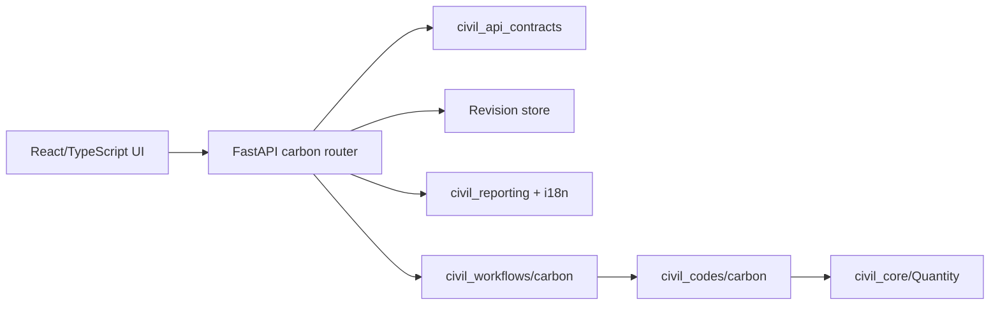

# กรอบวิจัยและแผนพัฒนาเครื่องมือประเมินคาร์บอนงานก่อสร้าง

สถานะ: 25 ตุลาคม 2026 — เอกสารออกแบบสำหรับ MVP ที่พัฒนาใน `apps/carbon_research_web/` และระยะถัดไป ข้อความนี้เป็นแนวทางวิจัย ไม่ใช่การรับรองคาร์บอนเครดิตหรือการรับรองทางวิศวกรรม

## 1. คำถามวิจัยและผลที่ต้องแยกกัน

1. **บัญชีการปล่อยของงานก่อสร้าง (embodied carbon):** โครงการหนึ่งปล่อยก๊าซเรือนกระจกเท่าใดในขอบเขตที่ประกาศ หน่วย kgCO₂e/tCO₂e และรายการใดเป็นตัวขับผลหลัก
2. **การเปรียบเทียบทางเลือก:** หาก BOQ วัสดุ ระยะขนส่ง พลังงานก่อสร้าง หรือแหล่ง factor เปลี่ยน ผลและความไม่แน่นอนเปลี่ยนเท่าใด ต้องใช้ขอบเขต หน่วยหน้าที่ และคุณภาพข้อมูลที่เทียบกันได้
3. **โอกาสเข้าโครงการเครดิต:** กิจกรรมใดตรงกับ *ระเบียบวิธีที่มีผลใช้* และมี baseline, additionality, monitoring, สิทธิ์ในเครดิต และหลักฐานเพียงพอ การลดตัวเลขในข้อ 1 เพียงอย่างเดียวไม่เท่ากับเครดิตที่ออกแล้ว

แนวทาง LCA อ้างอิง [ISO 14040](https://www.iso.org/standard/37456.html), [GHG Protocol Product Standard](https://ghgprotocol.org/product-standard) และกฎ EPD สำหรับผลิตภัณฑ์ก่อสร้าง [ISO 21930:2017](https://www.iso.org/standard/61694.html) การวางโครงการลดก๊าซเรือนกระจกและ MRV อ้างอิง [ISO 14064-2:2019](https://www.iso.org/standard/66454.html) โดยไม่คัดลอกเนื้อหามาตรฐานลง repository

## 2. ขอบเขตและหน่วยหน้าที่

MVP รับ A1–A3 (ผลิตวัสดุ), A4 (ขนส่งสู่หน้างาน), A5 (การก่อสร้าง/ติดตั้งและของเสียในช่วงนั้น) ผ่าน BOQ/ข้อมูลกิจกรรมที่ผู้ใช้ระบุ มิได้สมมติว่าขอบเขตนี้เป็น whole-life carbon ให้บันทึกสิ่งที่รวม/ไม่รวม อายุใช้งาน พื้นที่หรือความยาวอ้างอิง และสภาพพื้นที่ในคำอธิบายโครงการก่อนเทียบทางเลือก ระยะต่อไปควรแยก A1/A2/A3 และเพิ่ม B, C, D ตามกฎ/มาตรฐานที่ผู้วิจัยเลือก โดยบันทึกเวอร์ชันขอบเขตใน schema

| กลุ่มงาน | หน่วยหน้าที่ที่ควรระบุ | ประเด็นข้อมูลสำคัญ |
|---|---|---|
| ถนน | ต่อแนวทางหรือ lane-km พร้อมอายุและรูปตัด | ชั้นทาง แอสฟัลต์/คอนกรีต ดินขุด-ถม ระยะขนส่ง เครื่องจักร |
| สะพาน | ต่อสะพานหรือ m² deck พร้อมช่วงและระบบโครงสร้าง | คอนกรีต เหล็กเสริม/เหล็กรูปพรรณ ฐานราก falsework และขนส่ง |
| อาคาร | ต่ออาคารหรือ m² gross floor area พร้อมอายุและสเปก | โครงสร้าง เปลือกอาคาร ระบบประกอบอาคาร งานก่อสร้าง |
| สถาปัตย์/ตกแต่งภายใน | ต่อ m² พื้นที่ใช้งานพร้อมรอบการเปลี่ยนวัสดุ | ผิวพื้น ผนัง ฝ้า สี เฟอร์นิเจอร์ บรรจุภัณฑ์และของเสีย |

ตารางนี้เป็น checklist สำหรับเก็บข้อมูล ไม่ใช่ตัวคูณสำเร็จรูป ข้อมูลปริมาณและ factor ต้องมีหน่วย แหล่งข้อมูล เวอร์ชัน ปี ภูมิศาสตร์ ขอบเขตวงจรชีวิต และเอกสารหลักฐาน การใช้ EPD ต้องตรวจ PCR, declared/functional unit, โมดูลที่รายงาน, อายุและเงื่อนไขเทียบเคียง; ป้องกันการนับซ้ำระหว่าง factor ของวัสดุกับกิจกรรมขนส่ง/พลังงาน

## 3. วิธีคำนวณและข้อมูลที่ต้องตรวจสอบย้อนหลัง

สำหรับแถว BOQ: `ผลปล่อย = ปริมาณกิจกรรม ÷ ปริมาณฐานของ factor × ผลปล่อยฐานของ factor` หลังแปลงหน่วยเข้าสู่ชนิดมิติเดียวกัน ผลรวมตามช่วง/หมวด/โครงการเกิดจากแถวที่ผ่าน validation เท่านั้น ระบบไม่ใส่ emission factor อัตโนมัติ ทุก revision เก็บ input/output snapshot, เวลา, source/version, trace สูตรและ operands พร้อม SHA-256 ของ input เพื่อให้ทำซ้ำได้

ก่อนสรุปผลวิจัย ควรตรวจ: (ก) BOQ ครบและไม่มีซ้ำ (ข) factor ครอบคลุมโมดูลเดียวกับที่นับ (ค) หน่วยและ conversion ถูกต้อง (ง) ปี/พื้นที่/เทคโนโลยีเหมาะสม (จ) กรณีข้อมูลขาดถูกเปิดเผย (ฉ) sensitivity ของรายการที่กระทบผลมาก ระยะถัดไปควรแสดงช่วงค่าจากความไม่แน่นอนของ factor และ completeness score แยกจากค่า point estimate

## 4. เส้นทางคาร์บอนเครดิตและการซื้อขาย

MVP คัดกรองสองกรณีจากรายการระเบียบวิธีของ TGO: [อาคารประหยัดพลังงาน T-VER-S-METH-06-15 v01](https://tver.tgo.or.th/database/public/methodology/46?category_id=6&lang=en) และ [การใช้ CO₂ ในคอนกรีต T-VER-P-METH-14-02 v01](https://tver.tgo.or.th/database/public/methodology/99?lang=en) สำหรับกรณีคอนกรีต แหล่ง TGO ระบุขอบเขตเป็น ready-mix และไม่รวม precast/คอนกรีตรีไซเคิลตาม [PDF ระเบียบวิธี](https://tver.tgo.or.th/images/2025/T-VER-P-METH-14-02-CCU%20for%20Concrete.pdf) สำหรับอาคารต้องตรวจเงื่อนไขมาตรการ ประเภทอาคาร อุปกรณ์ใหม่และสมการย่อยตาม [PDF ระเบียบวิธี](https://tver.tgo.or.th/database/Uploads/Methodology/fc74fcfe-fb48-458f-a07a-3e60ce0353ac.pdf)

ผล `BE−PE−LE` ในแอปเป็นเพียง cross-check ของค่าที่ผู้ใช้ป้อน ยังไม่ได้คำนวณองค์ประกอบตามระเบียบวิธีครบ และยังไม่รวมการพิสูจน์ additionality, baseline ที่อนุมัติ, monitoring/calibration, leakage ทุกประเภท, ความเป็นเจ้าของสิทธิ์, double counting, การตรวจความใช้ได้และทวนสอบโดย VVB หรือการออกเครดิตโดย TGO ตาม [กระบวนการขอรับรองของ Standard T-VER](https://tver.tgo.or.th/standard-tver/project-development/issuance) จึงต้องคงสถานะ `estimate_not_issued` แม้ผลคัดกรองเป็น `potentially_applicable`

การคัดกรองสองวิธีข้างต้นไม่ใช่ข้อจำกัดว่าวัสดุอื่นไม่มีเครดิต ตัวอย่างเพิ่มเติมคือ [T-VER-P-METH-08-01 v02 สำหรับกระบวนการผลิตปูนซีเมนต์จากวัสดุทางเลือก](https://tver.tgo.or.th/database/public/methodology/98?lang=en) และ [กลุ่มวิธีจัดการขยะ รวมการคัดแยก/รีไซเคิลพลาสติก](https://tver.tgo.or.th/database/public/methodologies/1?category_id=9&lang=en) แต่ผู้ซื้อวัสดุไม่อาจถือว่าตนได้รับเครดิตของผู้ผลิตโดยอัตโนมัติ ต้องตรวจผู้พัฒนาโครงการ สิทธิ์ในเครดิต และเงื่อนไขของแต่ละวิธี แอปยังไม่คำนวณเครดิตสำหรับวิธีเหล่านี้

ก่อนวิเคราะห์ราคา/การซื้อขาย ต้องมีเลขโครงการและ vintage, registry status, serial number, ปริมาณที่ออกจริง, ผู้ถือสิทธิ์, ข้อจำกัดการโอน และหลักฐานการยกเลิกใช้ (retirement) แยกจากปริมาณที่คาดการณ์ ค่าเครดิตที่คาดการณ์ไม่ควรถูกนับเป็น inventory reduction โดยไม่มีการกำหนด claim และ double-counting policy ที่ชัดเจน

## 5. โครงสร้างเครื่องมือและลำดับพัฒนา

**MVP ที่ลงโค้ดแล้ว:** BOQ CSV/ป้อนมือ, A1–A5, 4 กลุ่มงาน, หน่วยและ trace, T-VER screening สองวิธี, project revision, เปรียบเทียบผลรวมกับ revision ล่าสุด, PDF/XLSX/DOCX, ภาษาไทย/อังกฤษ และ UI สี pastel

**ระยะวิจัยถัดไป:** (1) data dictionary และ factor registry ที่มีสิทธิ์ใช้งาน, วันที่มีผล, การทบทวนและ provenance; (2) scenario model ที่เปรียบเทียบตาม functional unit, stage/category และ sensitivity; (3) implementation สมการย่อยทีละระเบียบวิธีพร้อม worked examples จากแหล่งที่ได้รับอนุญาต; (4) evidence vault, monitoring series, reviewer workflow และ audit trail; (5) เชื่อม registry เฉพาะเมื่อมีสิทธิ์เข้าถึงและตรวจหมายเลขเครดิตจริง

**ก่อนใช้งานภายนอก:** ย้าย storage ไป PostgreSQL, เพิ่ม authentication/RBAC, tenant isolation, encryption/backup, audit, migration, rate limits, accessibility และ security testing ตาม release gate ของโครงการ ต้องมีการทวนสอบอิสระโดยผู้เชี่ยวชาญ LCA/วิศวกรรมและเจ้าของวิธี ก่อนอ้างผลเพื่อรับรองหรือซื้อขาย
